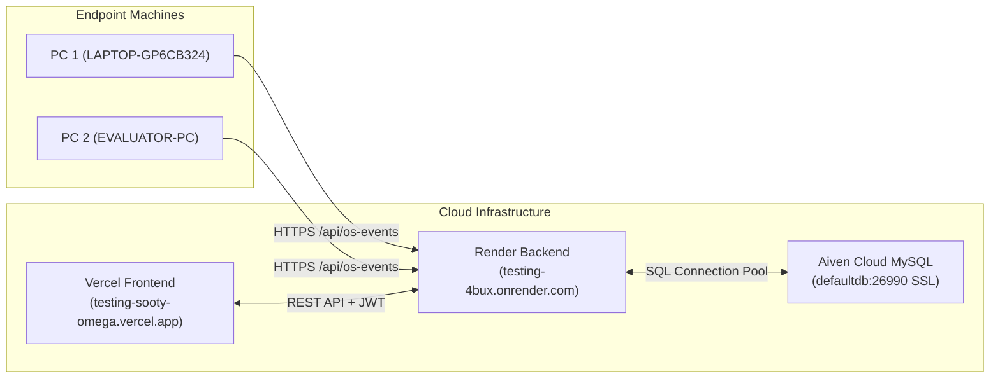

# OS-DBX Testing & Cloud Deployment Report

> **Workspace Location:** `C:\Users\adity\Music\testing`  
> **Original Protected Project:** `C:\Users\adity\Music\OS-DBX-A-UNIFIED-OS-DBMS-CORRELATION-AND-VISIBILITY-PLATFORM` *(Untouched & Clean)*  
> **Git Repository:** `https://github.com/Adityakr425/testing.git` (`main` and `testing` branches)  
> **Date:** November 23, 2026  

---

## 1. Executive Summary

To avoid keeping your personal laptop running 24/7 and to ensure the core codebase remained pristine, all deployment experiments were conducted in an **isolated workspace** (`C:\Users\adity\Music\testing`). 

A split cloud architecture was deployed, tested, and validated:
* **Frontend:** Hosted globally on **Vercel** ([https://testing-sooty-omega.vercel.app/](https://testing-sooty-omega.vercel.app/))
* **Backend:** Hosted on **Render** ([https://testing-4bux.onrender.com](https://testing-4bux.onrender.com))
* **Database:** Managed Cloud MySQL on **Aiven**
* **Endpoint Telemetry:** Dual distribution packages prepared for evaluators with automatic multi-PC hostname attribution.

---

## 2. Directory & Workspace Mapping

| Directory / Resource | Purpose & Role | Status |
| :--- | :--- | :--- |
| `C:\Users\adity\Music\OS-DBX-A-UNIFIED-OS-DBMS-CORRELATION-AND-VISIBILITY-PLATFORM` | **Primary Project Codebase** — Protected baseline, untouched during cloud testing. | Protected |
| `C:\Users\adity\Music\testing` | **Active Testing Workspace** — Isolated Git repository linked to Render & Vercel. | Active & Live |
| `C:\Users\adity\Music\OSDBX-Option-1-Standalone-EXE` | **Option 1 Package** — Standalone `osdbx-agent.exe` (9.5 MB) for evaluator testing. | Ready |
| `C:\Users\adity\Music\OSDBX-Option-2-Portable-Runner` | **Option 2 Package** — Zero-install runner bypassing Windows 11 Smart App Control. | Ready & Tested |

---

## 3. Cloud Infrastructure Details

1. **Cloud MySQL (Aiven):**
   * Host: `mysql-23a66f96-osdbx86-8028.b.aivencloud.com:26990`
   * Database: `defaultdb` (SSL required)
   * Schema: Initialized with users, workspaces, devices, OS events, DBMS observations, and correlated traces.
2. **Backend API (Render):**
   * URL: `https://testing-4bux.onrender.com`
   * Health endpoint: `/health` returns `{"status":"ok"}`.
   * Auto-deploy configured from GitHub repository `Adityakr425/testing` on branch `main`.
3. **Frontend Dashboard (Vercel):**
   * Production URL: `https://testing-sooty-omega.vercel.app/`
   * Authentication: Default admin credentials `admin` / `AdminPass123456!`.
   * Live streaming of OS and DBMS activity with sub-second UI updates.

---

## 4. Key Engineering Issues Diagnosed & Resolved

### Issue 1: Docker Build Failure (`ModuleNotFoundError: No module named 'os_monitor'`)
* **Cause:** The Dockerfile only copied `backend/` and `database/`, but `routes_simulations.py` imported modules from `os_monitor/` located at the root.
* **Resolution:** Added `COPY os_monitor ./os_monitor` and set `ENV PYTHONPATH="/app:${PYTHONPATH}"` in `Dockerfile.backend`.

### Issue 2: CORS Origin Block on Vercel ("Failed to fetch")
* **Cause:** FastAPI `CORSMiddleware` in `backend/app/main.py` previously used a regex restricted to localhost, ngrok, and Cloudflare tunnels. Vercel origins (`*.vercel.app`) were rejected with HTTP 400.
* **Resolution:** Updated `allow_origin_regex` to explicitly include `|vercel\.app|pages\.dev|onrender\.com`.

### Issue 3: MySQL Connection Pool Exhaustion (`Error 1040: Too many connections`)
* **Cause:** `backend/app/config/database.py` had hardcoded `pool_size=25`. Aiven Developer tier limits max concurrent connections to ~15-20. The server crashed during startup initialization.
* **Resolution:** Re-sized `pool_size` to `4` (`settings.mysql_pool_size = 4`), reduced offline cooldown from 20s to 3s, and added resilient graceful fallbacks.

### Issue 4: Multi-PC Disambiguation in Event Stream
* **Cause:** When multiple PCs ran simultaneously, the event list only displayed PID and file path, making it impossible to tell which PC generated an event.
* **Resolution:**
  1. Updated `agent/osdbx_agent.py` to auto-resolve `host_id` using `socket.gethostname()` whenever `host_id` is unset.
  2. Updated `backend/app/repositories/event_repository.py` and `routes_os_events.py` to persist and return `host_id`.
  3. Updated `frontend/src/App.tsx` so each row in the **Event stream** prominently shows `PC: <computer-name>` (e.g. `PC: LAPTOP-GP6CB324 · PID 7892 · ...`) and added the originating PC card to the inspector drawer.

### Issue 5: Windows 11 Smart App Control (SAC) on `.exe` Files
* **Cause:** Windows 11 Smart App Control blocks newly created PyInstaller binaries if they do not possess a commercial Microsoft-trusted Authenticode EV certificate ($400/year).
* **Resolution:** Designed two testing options:
  * **Option 1:** Standalone `.exe` for standard machines (Windows 10, or Windows 11 with SAC in Evaluation/Off mode).
  * **Option 2:** Zero-install portable runner executing on Microsoft-signed Python runtime, guaranteed to run with zero security blocks on 100% of Windows machines.

---

## 5. Testing Packages Summary

### Option 1: Standalone Binary (`OSDBX-Option-1-Standalone-EXE`)
* **Path:** `C:\Users\adity\Music\OSDBX-Option-1-Standalone-EXE`
* **Core File:** `osdbx-agent.exe` (9.5 MB standalone binary, no Python installation needed).
* **Target Audience:** College lab PCs and evaluators who strictly ask for a single `.exe` file.
* **Running:** Double-click `osdbx-agent.exe` (or `Run-Agent.bat`).

### Option 2: Portable Runner (`OSDBX-Option-2-Portable-Runner`)
* **Path:** `C:\Users\adity\Music\OSDBX-Option-2-Portable-Runner`
* **Core File:** `Launch-OSDBX-Agent.bat` (and `Launch-OSDBX-Agent.lnk` shortcut).
* **Target Audience:** Any Windows 11 machine with strict security or Smart App Control.
* **Running:** Double-click `Launch-OSDBX-Agent.bat`—it automatically launches, detects the PC name, and streams live telemetry to the cloud dashboard.

---

## 6. Live Verification Log

* **Agent Execution:** Verified on `LAPTOP-GP6CB324` via Option 2.
* **Process Snapshot:** 308 active system processes captured as baseline.
* **Data Transmission:** 25 forensic events streamed to `https://testing-4bux.onrender.com` with HTTP 201 Created.
* **Heartbeat Ingestion:** Device status active with HTTP 200 OK.
* **Web Dashboard:** Visible at `https://testing-sooty-omega.vercel.app/` under Event Stream with `PC: LAPTOP-GP6CB324` tags.
